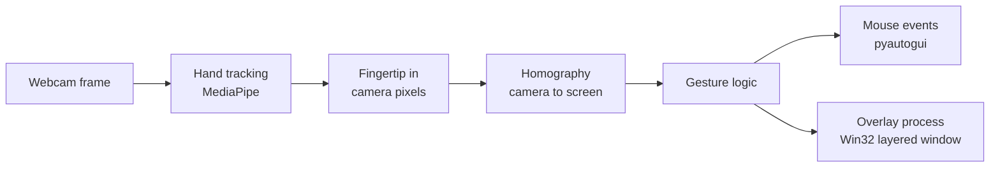

# Gesture control for a projector screen

Turns any projected image into a touch-free "whiteboard": a webcam watches the projection, and you
move the mouse and click by pointing at the wall with your hands. No special hardware, just a
camera, a projector and Python.

## How it works



1. **Calibration.** On start you click the four corners of the projected image in a camera snapshot.
   From these four point pairs the program computes the homography between camera and screen
   coordinates itself (direct linear transform, solved with an SVD in `calibration.py`).
2. **Hand tracking.** MediaPipe Hands finds both hands in every frame; the tip of the middle finger
   is mapped through the homography to a screen position (`processing.py`).
3. **Gestures.** The left hand moves the cursor. Bringing the right hand close to the left one
   presses the mouse button, moving it away releases it, so clicking and dragging both work.
   Short tracking drop-outs are bridged so a drag is not interrupted by a single missed frame
   (`perform_onscreen_actions.py`).
4. **Feedback overlay.** A transparent, click-through, always-on-top window draws rings around both
   hands and shows the click state. It runs in its own process and receives commands through a
   queue, so rendering never blocks the camera loop (`filterapp.py`).

## Requirements

- Windows (the overlay uses the Win32 API through `pywin32`)
- Python 3.10 or newer
- A webcam that sees the whole projection

## Run it

```bash
pip install -r requirements.txt
python main.py
```

Before the first run, adjust `config.py`:

| Setting | Meaning |
|---|---|
| `CAMERA_INPUT` | Index of the webcam |
| `MONITOR_RESOLUTION` | Resolution of the projected screen |
| `HAND_CURSOR_CLICK_DISTANCE` | Distance between the hands (in screen pixels) below which the mouse button is pressed |
| `INAROW_HAND_DETECTION_FAILS` | Missed frames after which a hand counts as gone |
| `DEBUG` | Shows the camera image with the detected hand landmarks |

Then click the four corners of the projection in the calibration window, starting at the top left
and going round to the bottom left, and confirm with Enter. Corners can be dragged to correct them.

## Project layout

| File | Role |
|---|---|
| `main.py` | Wires camera, calibration, hand detection and controller together |
| `calibration.py` | Corner selection UI and homography |
| `processing.py` | Hand detection and coordinate mapping |
| `perform_onscreen_actions.py` | Gesture state machine, mouse control, unit tests |
| `filterapp.py` | Overlay window in a separate process |
| `experiments/` | Small standalone scripts used while developing |

## Status and open points

This is a working prototype from 2023. It grew out of an earlier single-file version; this
repository is the reworked one with the non-blocking overlay.

- A presentation mode (next/previous slide by pointing at the screen edges) is prepared in the
  configuration but not implemented.
- The overlay window occasionally blacks out and is re-applied periodically as a workaround.
- Closing the overlay does not yet stop the whole application.
- Windows only.

## License

See [LICENSE](LICENSE).
